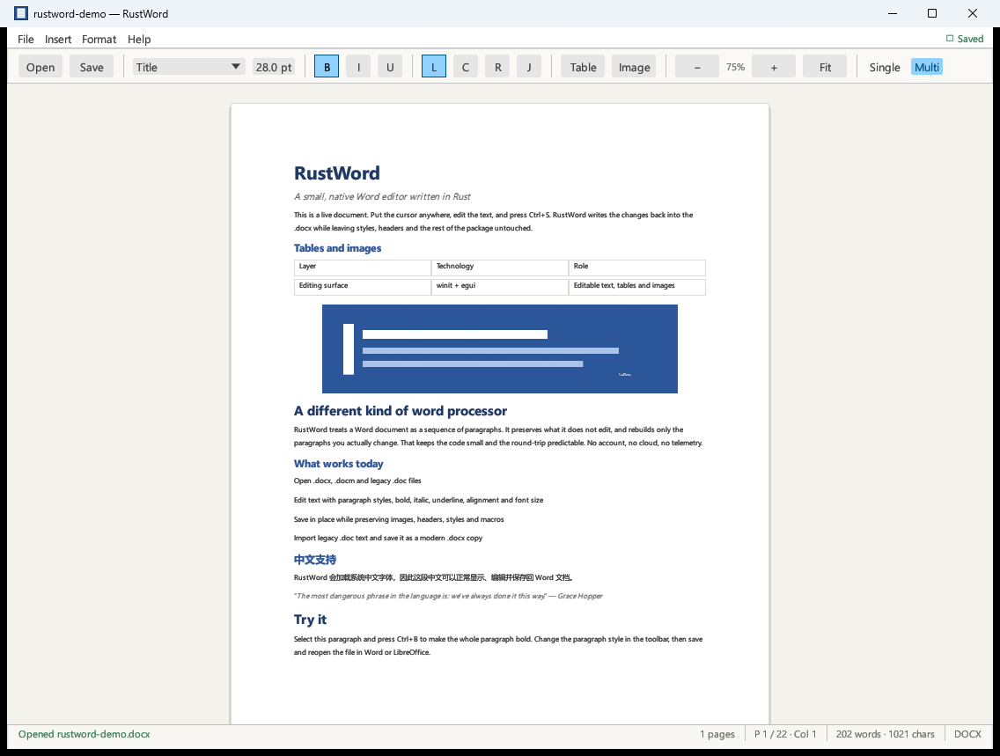

# RustWord

A minimal, native Word editor written in Rust.



RustWord opens modern Word documents, lets you edit paragraphs, tables and
images on a Word-like page, and writes the changes back into the original
`.docx` package. It is a focused desktop app, not a Word replacement.

## Features

- Open and edit `.docx` and macro-enabled `.docm` files.
- Import legacy Word 97–2003 `.doc` files as editable text.
- Save in place with `Ctrl+S`, or save a copy with `Ctrl+Shift+S`.
- Paragraph styles: Normal, Title, Subtitle, Heading 1–3, Quote.
- Bold, italic, underline, alignment, font size.
- **Editable tables**: insert a table, edit every cell, and add/remove rows and
  columns. Table widths, row heights, cell margins, vertical alignment, cell
  shading and merged-cell properties are retained. Multi-paragraph cells stack
  correctly.
- **Inline images**: display PNG, JPEG and WebP images (including WebP data
  stored under a `.png` part name), insert new images, resize them, and remove
  them. New images are written as proper OOXML media parts with relationships
  and content types.
- **Pagination**: page size and margins are read from the document's `sectPr`;
  page/section breaks are honoured and page numbers are drawn in the footer
  area. Use **Single** page view or the continuous **Multi** page view.
- **Zoom**: 40%–200%, plus a **Fit** button that fits the whole page to the
  window.
- System font loading, including Chinese/CJK text.
- Unsaved-change prompts, drag-and-drop opening, keyboard shortcuts.
- Preserves package parts that it does not edit: styles, headers, footers,
  embedded objects, macros (in `.docm`), and section settings.
- Unchanged paragraphs, tables and images are copied back byte-for-byte from
  `document.xml`.
- Changed paragraphs keep their paragraph properties (spacing, indentation,
  numbering) and are rebuilt as a single formatted run.

## Run

Download the latest Windows build from
[GitHub Releases](https://github.com/liqiangdu/rustword/releases/latest), then
open a document by dragging it onto the window, using **File ▸ Open…**, or by
passing a path:

```powershell
.\RustWord.exe .\samples\rustword-demo.docx
```

Build from source (Rust 1.82+):

```powershell
cargo build --release
.\target\release\rustword.exe
```

## Keyboard shortcuts

| Shortcut | Action |
| --- | --- |
| `Ctrl+O` | Open |
| `Ctrl+S` | Save |
| `Ctrl+Shift+S` | Save As |
| `Ctrl+N` | New document |
| `Ctrl+B` / `Ctrl+I` / `Ctrl+U` | Bold / italic / underline the active paragraph |
| `Ctrl++` / `Ctrl+-` / `Ctrl+0` | Zoom in / out / reset to 100% |
| `Ctrl+1` / `Ctrl+2` | Single-page / multi-page view |
| `Ctrl+Z` / `Ctrl+Y` | Undo / redo text editing |

Formatting buttons and shortcuts apply to the paragraph containing the caret.
Use the **Table** button to insert a table, and the **Image** button to insert a
PNG or JPEG. When a table cell is active, the toolbar exposes row and column
controls. Click an image to select it; the toolbar then shows a width control and
a Remove button.

## Legacy `.doc` files

The old Word 97–2003 binary format is import-only. RustWord reads the main text
story and gives you an editable document. Saving asks for a new `.docx` path;
the original `.doc` is never overwritten. This keeps the app honest: writing a
full legacy binary Word file is outside the scope of a minimal editor.

## Scope and known limitations

This is intentionally a small editor. It is not a full Word clone.

- Text is edited as paragraphs, not as a full rich-text surface. Editing a
  paragraph rebuilds it as one run, so mixed inline formatting inside *that*
  paragraph is simplified. Untouched paragraphs keep their original runs.
- Formatting applies to the active paragraph, not an arbitrary character range.
- Images are shown as blocks when they are alone in a paragraph (the usual
  inline-image layout). An image that shares a paragraph with text is preserved
  but not displayed. Floating shapes, charts, headers, footers, footnotes,
  comments, and tracked changes are also preserved but not displayed.
- Tables use a simplified grid. Merged cells display and edit correctly and
  their properties are preserved, but structural row/column controls are
  disabled for merged tables. Nested tables are preserved but not editable.
  There is no merge-cell or table-style UI.
- Pagination is page-oriented, not a full Word layout engine. A table is moved
  to the next page when it does not fit; tables are not split across pages, and
  an extremely tall table can overflow its page. Paragraphs are kept whole.
- Page numbers are generated by RustWord. Existing page headers and footers are
  preserved in the package but are not rendered in the editor.
- Find/replace, spell check, list editing, and PDF export are not implemented.
- The legacy `.doc` importer reads the main text story only; it does not import
  formatting, tables, or images.

## How it works

- `src/app.rs` — native egui/eframe UI, pagination and page views, zoom, table
  and image widgets, toolbar, dialogs, shortcuts.
- `src/docx.rs` — ZIP/OOXML reading, block model (paragraphs, tables, images,
  raw blocks), relationships/media, and conservative XML writing.
- `src/legacy_doc.rs` — OLE compound file + Word 97 FIB/piece-table text
  extraction.
- `samples/` — demo and test fixtures.
- `examples/roundtrip_check.rs` — edits a paragraph and table cell in the rich
  fixture for external validation.
- `examples/image_check.rs` / `examples/table_check.rs` — exercise new media and
  table package generation.
- `examples/make_legacy.rs` — generates the synthetic Word 97 fixture.

On save, unchanged blocks are emitted from their original XML. Edited
paragraphs and tables are rebuilt from the model. The writer opens the original
ZIP, copies every unrelated part without recompressing it, adds new media and
updated relationships/content types when needed, and replaces the destination
through a temporary file. For a new document, a small valid OOXML package is
generated from scratch.

## Tests

```powershell
cargo test
```

The tests cover paragraph/table/image parsing, page settings and break markers,
multi-paragraph cell layout, table widths/row heights/margins/vertical
alignment, paragraph splitting, table editing and row/column changes, image
insertion and resizing, image/table preservation, new-document generation,
in-place saving, and the legacy `.doc` reader. Saved packages are also checked
with `python-docx` during development; the fixes were verified against a real
21-table, 4-chart research report.

## License

MIT. See [LICENSE](LICENSE).
